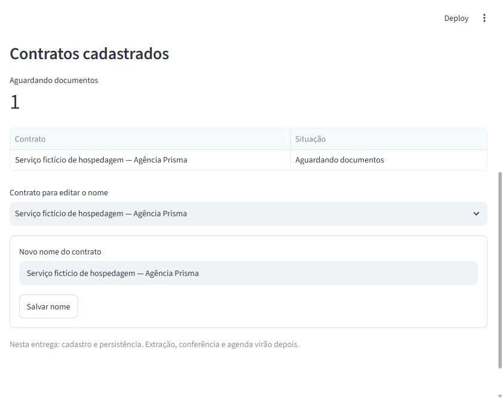

# Radar de Obrigações Contratuais

Aplicação local para o Desafio Livre de novembro/dezembro de 2026 da Jornada de Dados.

**Situação em 01/11/2026:** fundação executável e verificada no Windows, com ambiente isolado, módulos separados, banco com migração, cadastro/edição de contratos fictícios, histórico e backup. **34 testes passaram.** O repositório Git é local; publicação, CI remota e proteção da principal ainda estão pendentes.

A primeira versão de produto acompanhará renovações e avisos prévios de contratos da Agência Prisma, um negócio fictício. A fundação atual permite cadastrar e editar nomes; extração, revisão documental e agenda ainda serão implementadas. Não há IA nem comunicação externa nesta entrega.

## Executar no Windows

Pré-requisito: Python **3.14.3**, com `python` acessível no terminal. Abra PowerShell na pasta do projeto. Os scripts funcionam sem ativar manualmente um ambiente e sem alterar pacotes globais.

```powershell
.\scripts\Preparar-Ambiente.ps1
.\scripts\Iniciar-Radar.ps1
```

O primeiro comando instala o uv **0.13.6** em `.tools/bootstrap`, sincroniza as dependências de `uv.lock` em `.venv` e aplica a migração. O segundo inicia a interface em [http://127.0.0.1:8501](http://127.0.0.1:8501). Encerre a execução iniciada no terminal com `Ctrl+C`.

Cadastre apenas um contrato fictício, informe um nome de personagem como responsável e confirme o contexto de simulação. O registro aparece como **Aguardando documentos** e permanece após recarregar a página. É possível editar seu nome; uma edição desatualizada é rejeitada.

O banco é criado em `var/radar.sqlite3`, fora do Git. Para escolher outro diretório local, defina `RADAR_DATA_DIR` na sessão antes de preparar/iniciar. Nenhuma chave de API é necessária. Os scripts não carregam `.env` automaticamente.

## Verificar e fazer backup

```powershell
.\scripts\Validar-Projeto.ps1
.\.tools\bootstrap\Scripts\uv.exe run --locked radar backup
```

A verificação inclui código, formatação, testes, links locais e dependências. O backup cria um novo arquivo em `var/backups/`, sem sobrescrever um destino existente. O teste de restauração usa outro banco temporário e preserva o banco de execução.

Em um ambiente que restrinja conexões locais ou a pasta temporária, os testes de interface precisam da liberação dessas operações pelo ambiente. Não altere o código para esconder uma falha de infraestrutura; o [registro de validação](docs/validacao-fundacao.md) explica o que foi executado nesta máquina.

## Evidência da interface

Cadastro fictício conferido no navegador e preservado após recarregar:



## Comece aqui

| Documento | O que você encontra |
|---|---|
| [Discovery](docs/discovery/radar-obrigacoes-contratuais.md) | Case fictício, dor, entrevista simulada, riscos e hipóteses |
| [PRD](docs/PRD.md) | Objetivo, primeira versão, exclusões e critérios de aceitação propostos |
| [SPEC do primeiro fluxo](docs/specs/001-primeiro-fluxo.md) | Regras de datas, evidências, revisão, versões, falhas e cenários verificáveis |
| [Arquitetura](docs/arquitetura.md) | Aplicação local, módulos, dependências, dados e tratamento de reexecuções/falhas |
| [Validação da fundação](docs/validacao-fundacao.md) | Ambiente, verificações executadas e limites do que está comprovado |
| [Agent Harness](docs/agent-harness.md) | Uso do Codex, contexto, automações e direção humana |
| [Governança do repositório](docs/governanca-repositorio.md) | Git local, CI preparada e controles remotos ainda pendentes |
| [ADR-001 — recorte aceito](docs/adrs/001-recorte-do-produto.md) | Escolha de produto feita por Lucas, alternativas e consequências |
| [ADR-002 — separação de responsabilidades](docs/adrs/002-proposta-limites-extracao-e-confirmacao.md) | Proposta de separar extração, cálculo e confirmação; ainda não aceita |
| [ADR-003 — aplicação local modular](docs/adrs/003-aplicacao-local-modular.md) | Direcionamento escolhido por Lucas, alternativas e limites |
| [ADR-004 — tecnologias aceitas](docs/adrs/004-proposta-tecnologias-locais.md) | Ferramentas escolhidas, alternativas e verificações ainda necessárias |
| [ADR-005 — persistência da fundação](docs/adrs/005-persistencia-da-fundacao.md) | Transação, reenvio, histórico e controle de edição implementados |
| [Evolução da arquitetura](docs/evolucao-arquitetural.md) | Etapa futura solicitada: cenário de crescimento, medições e proposta de evolução |
| [Plano de entrega](docs/plano-de-entrega.md) | Marcos, dependências, primeiras tarefas e roteiro de demonstração |
| [Planejamento inicial](docs/planejamento-inicial.md) | Exigências oficiais, comparação de ideias e calendário provisório |

O próximo marco funcional é receber documentos sintéticos com origem e versão, seguindo a SPEC. O [plano de entrega](docs/plano-de-entrega.md) mantém os passos de produto e a proposta futura de evolução para escala e desempenho. Desempenho sob carga e qualidade da extração ainda não foram avaliados.

## Referências oficiais

- [Enunciado do Desafio Livre](https://github.com/suajornadadedados/desafio-jornada/blob/main/desafio-livre/README.md)
- [Regras de submissão](https://github.com/suajornadadedados/desafio-jornada/blob/main/COMO-SUBMETER.md)

Consulta realizada em 31/10/2026. O encerramento está previsto para a primeira quinzena de dezembro de 2026, com dia ainda a confirmar no enunciado consultado.

## Limites do case

Os dados do produto serão sintéticos e as ações de negócio serão simuladas, conforme o desafio. Resultados de simulação serão identificados como tal.
