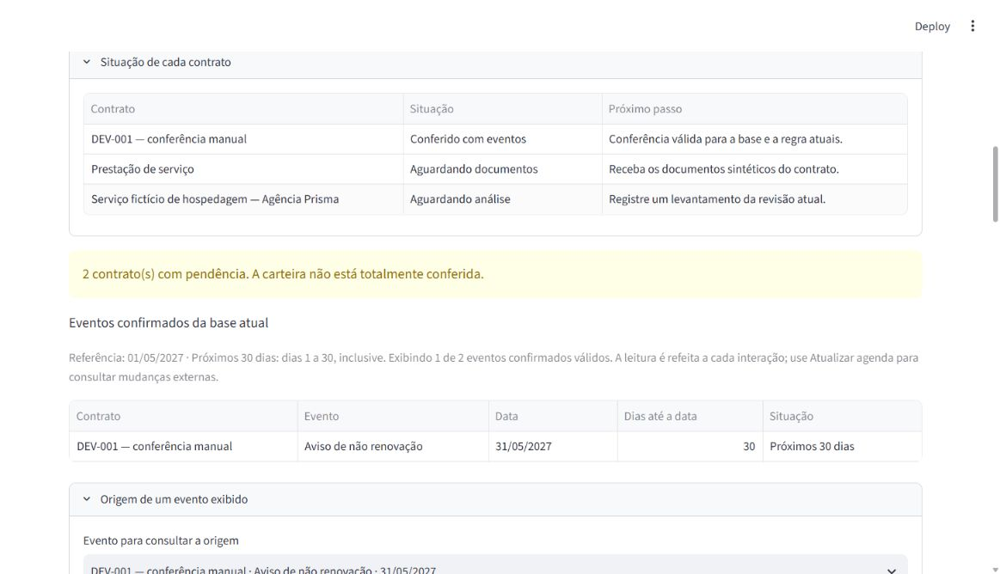

# Radar de Obrigações Contratuais

Aplicação local para o Desafio Livre de novembro/dezembro de 2026 da Jornada de Dados.

**Entrega local em 05/11/2026:** Lucas informou o [aceite funcional e a revisão dos PRs #1–#13](docs/entrega/aceite-funcional.md), autorizando a integração. Use a `main` após a conclusão do [PR #13](https://github.com/LucasGoulartCouto/radar-obrigacoes-contratuais/pull/13); a descrição identifica o resultado, o commit integrado e a CI finais. A linha funcional mais recente passou em **383 testes locais**, incluindo a [correção de concorrência](docs/validacao-concorrencia-gravacao.md) encontrada durante a integração. Isso não é avaliação independente do modelo ou aprovação de produção.

**Reprodução e entrega:** [guia de instalação](docs/entrega/reproducao.md), [registro da reprodução de 02/11](docs/validacao-reproducao.md) e [materiais](docs/entrega/README.md). Naquela reprodução, 371 testes passaram em ambiente/banco novos nesta máquina, com runtime de IA reutilizado. A [correção de validade](docs/validacao-validade-do-metodo.md) acrescentou a migração 0005 e exige reconferência após mudança de método mesmo com datas iguais. Depois de atualizar o código, execute `scripts/Preparar-Ambiente.ps1` antes de iniciar. Cartão e posts continuam rascunhos, sem URLs de divulgação fornecidas ou envio pelo agente.

**Retomando em outra sessão?** Leia [AGENTS.md](AGENTS.md) e o [ponto de retomada](docs/RETOMADA.md), que identifica a branch funcional, PRs, evidências e próximo passo. Confira o estado atual no Git antes de continuar.

**Histórico da integração assistida:** tentativas persistidas, revisão na tela, recuperação explícita e confirmação separada foram implementadas no [PR #11](https://github.com/LucasGoulartCouto/radar-obrigacoes-contratuais/pull/11), com 371 testes naquele snapshot. A [validação de 02/11](docs/validacao-integracao-assistida.md) distingue testes, duas inferências reais e revisão simulada; o aceite de Lucas em 05/11 é um registro posterior.

A fundação entrou pelo [PR #1](https://github.com/LucasGoulartCouto/radar-obrigacoes-contratuais/pull/1). Uma falha temporária comprovou o bloqueio da integração na preparação do repositório; o arquivo da prova foi removido. Veja a [validação histórica da publicação](docs/validacao-publicacao.md).

A primeira versão acompanha renovações e avisos prévios do case fictício da Agência Prisma. Recebe textos sintéticos, preserva originais e oferece levantamento manual ou análise assistida local. O código valida os literais e calcula o aviso; a conferência e a confirmação são separadas. Somente eventos da base atual alimentam a agenda. Histórico e tentativas anteriores permanecem acessíveis. Não há comunicação externa de negócio.

**Regras e casos do primeiro fluxo:** [decisão de produto](docs/decisoes-primeiro-fluxo.md) e [20 casos sintéticos de desenvolvimento](tests/fixtures/contracts/README.md), com 21 documentos e gabarito. Os oito iniciais foram preservados na ampliação do experimento offline. Lucas aceitou o ADR-002; os limites de entrada foram implementados no ADR-006. Esses exemplos ainda não são uma avaliação de extração. As verificações da entrada estão no [registro documental](docs/validacao-entrada-documental.md).

**Verificação local da versão com documentos:** 81 testes aprovados, incluindo migração com dados e os 38 testes novos da entrada. Upload, reenvio, alteração, rejeição por tamanho e download do original foram conferidos no navegador.

**Verificação local da versão com conferência:** 123 testes aprovados. O [registro da conferência](docs/validacao-conferencia-manual.md) distingue testes, migração e demonstração simulada no navegador de uma revisão humana real.

**Verificação local da agenda:** 165 testes aprovados, incluindo 42 novos. O [registro da agenda](docs/validacao-agenda.md) relaciona cada funcionalidade aos testes e à demonstração no navegador. A [matriz dos PRs anteriores](docs/evidencias-testes-por-pr.md) preserva a rastreabilidade das entregas encadeadas.

## Executar no Windows

Pré-requisito: Python **3.14.3**, com `python` acessível no terminal. Abra PowerShell na pasta do projeto. Os scripts funcionam sem ativar manualmente um ambiente e sem alterar pacotes globais.

```powershell
.\scripts\Preparar-Ambiente.ps1
.\scripts\Iniciar-Radar.ps1
```

O primeiro comando instala o uv **0.13.6** em `.tools/bootstrap`, sincroniza `uv.lock` em `.venv`, cria backup de banco existente e aplica as migrações. O segundo inicia a interface em [http://127.0.0.1:8501](http://127.0.0.1:8501). Encerre a execução iniciada no terminal com `Ctrl+C`.

Cadastre apenas um contrato fictício, informe um nome de personagem como responsável e confirme o contexto de simulação. Na cobertura, o registro aparece como **Aguardando análise**, com orientação para receber documentos, e permanece após recarregar. É possível editar seu nome; uma edição desatualizada é rejeitada.

Em **Documentos do contrato**, selecione os documentos atuais que deseja manter, adicione arquivos `.txt` sintéticos e informe seus papéis. Salvar envia o conjunto completo; arquivos retirados continuam nas revisões anteriores. Os limites padrão são **262.144 bytes por arquivo, 1.048.576 bytes por conjunto e 5 documentos**. Não há truncamento. Os parâmetros opcionais estão em `.env.example` e devem ser definidos na sessão.

O reenvio de mesmo texto e papel mantém a revisão, inclusive quando muda apenas o nome, BOM ou quebra de linha. Os bytes de cada envio aceito ficam disponíveis no histórico. Aditivo declarado mantém o bloqueio mesmo se for retirado do conjunto; o Radar não consolida seus efeitos. Veja o [registro de validação](docs/validacao-entrada-documental.md).

Em **Análise assistida dos documentos**, confirme o contexto sintético e solicite a análise. Ela executa somente no computador e grava uma tentativa; não confirma eventos nem substitui um resultado escolhido anteriormente. Consulte texto completo, classificações e pendências. **Usar resultado para conferência** seleciona a proposta; confirmar continua sendo outra ação. Retenções de contexto suportadas exigem decisão localizada e justificativa; conflitos/aditivos/unidades inválidas continuam bloqueados. Tentativa incompleta pode ser encerrada explicitamente para permitir nova tentativa, preservando o histórico.

Para habilitar a IA de desenvolvimento, siga [IA local](docs/ia-local.md) e execute `powershell -File scripts/Preparar-IA-Local.ps1` antes de iniciar. `Iniciar-Radar.ps1` reutiliza `.tools/ollama/model.json` ou `RADAR_LOCAL_MODEL_DIGEST`, sem escolher outro modelo. Sem configuração local, o caminho manual permanece disponível. O teste do fluxo integrado e seus limites estão na [validação](docs/validacao-integracao-assistida.md); a instalação limpa completa é a próxima etapa.

Em **Candidatos e conferência**, registre manualmente o resultado, selecione as linhas de evidência e salve o levantamento. A data do aviso é calculada pelo código. Os candidatos permanecem pendentes até a ação separada **Confirmar conferência**, após verificar campos, significado dos trechos e cobertura do texto. Ausência de eventos exige declaração específica. Corrigir um levantamento exige motivo e nova conferência; alterações documentais invalidam os eventos da visão atual sem apagar o histórico. Os responsáveis informados são personagens da simulação.

Em **Agenda e cobertura**, escolha a data de referência da simulação: o padrão é **01/05/2027**, com horizonte fixo de **30 dias**. Filtre situações de prazo e tipo de evento; “Depois do horizonte” permite consultar datas mais distantes. Limpar os filtros deixa a lista vazia e mantém a cobertura de todos os contratos. Apagar a referência pede uma data, sem inventá-la. Use **Origem de um evento exibido** para conferir trechos, cálculo e base; **Atualizar agenda** refaz a leitura de mudanças externas. Uma nova sessão volta à referência padrão. Consultar não altera confirmações.

O banco é criado em `var/radar.sqlite3`, fora do Git. Para escolher outro diretório local, defina `RADAR_DATA_DIR` na sessão antes de preparar/iniciar. Nenhuma chave de API é necessária. Os scripts não carregam `.env` automaticamente.

**Abertura e recuperação local em revisão:** a aplicação exige o banco já preparado, sem criar um arquivo vazio ao iniciar. Falhas de abertura ou da lista geram mensagem, preservam o arquivo e permitem nova tentativa por recarga; não são tratadas como lista vazia. [Validação e limites](docs/validacao-abertura-segura.md); HEAD/CI finais no [PR #16](https://github.com/LucasGoulartCouto/radar-obrigacoes-contratuais/pull/16). A criação/atualização do esquema continua no comando de preparo.

## Verificar e fazer backup

```powershell
.\scripts\Validar-Projeto.ps1
.\.tools\bootstrap\Scripts\uv.exe run --locked radar check-db
.\.tools\bootstrap\Scripts\uv.exe run --locked radar backup
```

A verificação inclui código, formatação, testes, links locais e dependências. O backup cria um novo arquivo em `var/backups/`, sem sobrescrever um destino existente. O teste de restauração usa outro banco temporário e preserva o banco de execução.

**Diagnóstico local em revisão:** `radar check-db` consulta o banco existente em somente leitura e apresenta esquema básico, quick_check, FKs e CHECKs do modelo separadamente. Retorna 0 para sucesso e 1 para pendência/falha; não cria, migra ou repara o banco. [Uso, testes e limites](docs/diagnostico-local.md); HEAD/CI finais no [PR #17](https://github.com/LucasGoulartCouto/radar-obrigacoes-contratuais/pull/17), dependente de #16. Esse resultado não substitui um teste de restauração ou validação de obrigações.

Em um ambiente que restrinja conexões locais ou a pasta temporária, os testes de interface precisam da liberação dessas operações pelo ambiente. Não altere o código para esconder uma falha de infraestrutura; o [registro de validação](docs/validacao-fundacao.md) explica o que foi executado nesta máquina.

## Evidência da interface

Agenda com um aviso confirmado, referência explícita e contratos pendentes:



## Comece aqui

**M7 aprovada em 07/11/2026 — continuidade local L:** [aceite de Lucas](docs/entrega/aceite-m7.md), [estudo e diagrama](docs/m7-proposta.md), [baseline sintético local](docs/validacao-m7.md) e [custos](docs/m7-custos.md). Protótipo compartilhado adiado; a aplicação mantém a arquitetura local. M7 acrescentou quatro testes do medidor, totalizando 387 na CI Windows/Linux do snapshot de estudo. Resultado da integração e CI finais na descrição do [PR #14](https://github.com/LucasGoulartCouto/radar-obrigacoes-contratuais/pull/14).

| Documento | O que você encontra |
|---|---|
| [Discovery](docs/discovery/radar-obrigacoes-contratuais.md) | Case fictício, dor, entrevista simulada, riscos e hipóteses |
| [PRD](docs/PRD.md) | Objetivo, primeira versão, exclusões e critérios de aceitação propostos |
| [SPEC do primeiro fluxo](docs/specs/001-primeiro-fluxo.md) | Regras de datas, evidências, revisão, versões, falhas e cenários verificáveis |
| [Arquitetura](docs/arquitetura.md) | Aplicação local, módulos, dependências, dados e tratamento de reexecuções/falhas |
| [Validação da fundação](docs/validacao-fundacao.md) | Ambiente, verificações executadas e limites do que está comprovado |
| [Validação da entrada documental](docs/validacao-entrada-documental.md) | Migração com dados, revisões, reenvio e envio/download reais pela interface |
| [Validação da conferência](docs/validacao-conferencia-manual.md) | Candidatos, evidências, confirmação separada e preservação do histórico |
| [Validação da agenda](docs/validacao-agenda.md) | Prazos, filtros, cobertura, origem e matriz de testes da entrega |
| [Evidências dos PRs anteriores](docs/evidencias-testes-por-pr.md) | Testes e registros de execução ligados às funcionalidades de cada PR |
| [Mapa dos agentes](AGENTS.md) | Rotas de leitura por tarefa, limites essenciais e comandos |
| [Agent Harness](docs/agents/harness.md) | Uso do Codex, contexto, automações e direção humana |
| [Governança do repositório](docs/governanca-repositorio.md) | Histórico Git, CI executada e controles ativos na principal |
| [Validação da publicação](docs/validacao-publicacao.md) | Repositório, PR, CI real e prova do bloqueio da principal |
| [ADR-001 — recorte aceito](docs/adrs/001-recorte-do-produto.md) | Escolha de produto feita por Lucas, alternativas e consequências |
| [ADR-002 — separação de responsabilidades](docs/adrs/002-proposta-limites-extracao-e-confirmacao.md) | Decisão aceita de separar extração, cálculo e confirmação; fluxo completo ainda a implementar |
| [Decisões do primeiro fluxo](docs/decisoes-primeiro-fluxo.md) | Regra aceita, limites de entrada aplicados e processamento futuro |
| [Casos sintéticos](tests/fixtures/contracts/README.md) | Oito casos de desenvolvimento com documentos e respostas esperadas |
| [ADR-003 — aplicação local modular](docs/adrs/003-aplicacao-local-modular.md) | Direcionamento escolhido por Lucas, alternativas e limites |
| [ADR-004 — tecnologias aceitas](docs/adrs/004-proposta-tecnologias-locais.md) | Ferramentas escolhidas, alternativas e verificações ainda necessárias |
| [ADR-005 — persistência da fundação](docs/adrs/005-persistencia-da-fundacao.md) | Transação, reenvio, histórico e controle de edição implementados |
| [ADR-006 — entrada documental](docs/adrs/006-entrada-e-revisoes-documentais.md) | Identidade das revisões, originais, limites e consequências implementadas |
| [ADR-007 — levantamento e conferência](docs/adrs/007-levantamento-manual-e-conferencia.md) | Baseline manual, confirmação atômica, correções e invalidação da base antiga |
| [ADR-008 — agenda e cobertura](docs/adrs/008-agenda-e-cobertura-da-carteira.md) | Leitura consistente, horizonte de 30 dias, filtros e cobertura independente |
| [Evolução da arquitetura](docs/evolucao-arquitetural.md) | M7 aprovada: cenários, medição local e alternativas; continuidade em L |
| [IA local](docs/ia-local.md) | Preparo do runtime, modelo provisório, rodada real e limitações |
| [Comparação de extração](docs/comparacao-extracao.md) | Experimento offline por regras, falhas mensuradas e protocolo para avaliar IA |
| [Validação do experimento](docs/validacao-experimento-extracao.md) | Evidências por comportamento, testes e limites do benchmark |
| [Integração assistida](docs/validacao-integracao-assistida.md) | Matriz por funcionalidade, migração, inferência real e revisão simulada no navegador |
| [ADR-013 — execução assistida](docs/adrs/013-execucao-e-conferencia-assistidas.md) | Tentativas, seleção, recuperação, bloqueios e limites da integração local |
| [Plano de entrega](docs/plano-de-entrega.md) | Marcos, dependências, primeiras tarefas e roteiro de demonstração |
| [Planejamento inicial](docs/planejamento-inicial.md) | Exigências oficiais, comparação de ideias e calendário provisório |

O baseline offline, as rodadas locais e a regressão de prompt permanecem preservados. A referência automática continua em 18/20 casos integrais, sem avaliação reservada; correções simuladas de contexto são identificadas separadamente. A aplicação integra o protocolo por linhas para desenvolvimento, mantendo o modelo provisório e a confirmação humana. PRs #1–#13 integrados após revisão de Lucas; M7 aprovada com continuidade local L, conforme o [aceite](docs/entrega/aceite-m7.md). Reprodução e materiais têm registros próprios no [plano de entrega](docs/plano-de-entrega.md); divulgação e galeria continuam pendentes de instrução específica. Produção e escolha definitiva do modelo continuam fora desta decisão.

## Referências oficiais

- [Enunciado do Desafio Livre](https://github.com/suajornadadedados/desafio-jornada/blob/main/desafio-livre/README.md)
- [Regras de submissão](https://github.com/suajornadadedados/desafio-jornada/blob/main/COMO-SUBMETER.md)

Consulta realizada em 31/10/2026. O encerramento está previsto para a primeira quinzena de dezembro de 2026, com dia ainda a confirmar no enunciado consultado.

## Limites do case

Os dados do produto serão sintéticos e as ações de negócio serão simuladas, conforme o desafio. Resultados de simulação serão identificados como tal.
