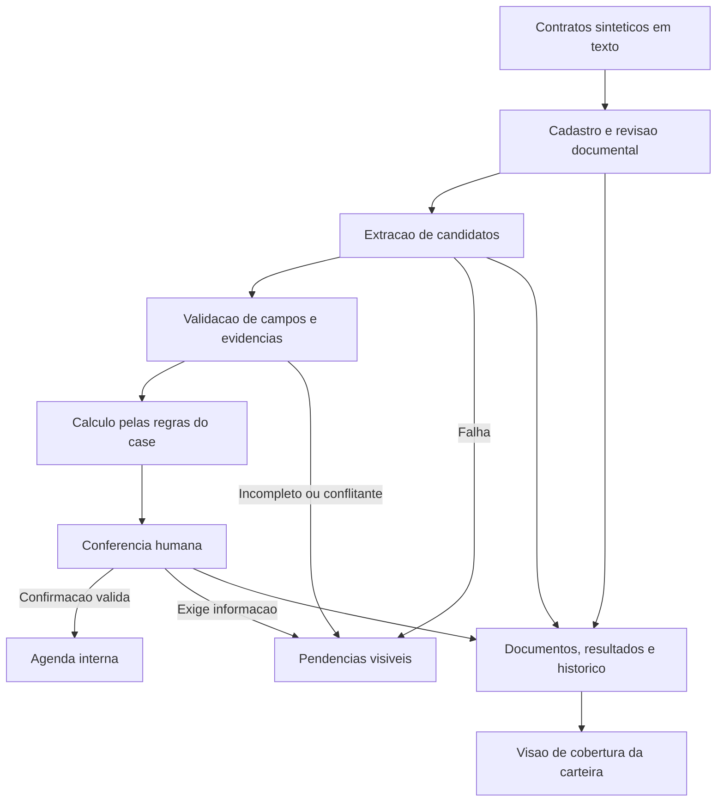

# Arquitetura — aplicação local modular

**Desenvolvimento local em 07/11/2026:** [perfil e melhoria em revisão](validacao-desempenho-local.md). Recibo já persistido pode ser devolvido por leitura encerrada; operações novas mantêm reserva de escrita e rechecagem. Agenda executa a mesma projeção por conexão Core, sem processamento ORM. Sem mudança de regra, esquema ou autoridade; a meta de latência concorrente continua aberta.

**M7 aprovada em 07/11/2026:** Lucas escolheu continuar na versão local L. [Aceite](entrega/aceite-m7.md), [estudo de evolução](m7-proposta.md), [baseline](validacao-m7.md) e [ADR-014 aceito para L](adrs/014-evolucao-condicional-para-uso-compartilhado.md). Protótipo C adiado; PostgreSQL, worker e controles remotos não foram implementados. As seções históricas abaixo descrevem a evolução da aplicação local.

**Atualização de 02/11/2026:** a integração de desenvolvimento acrescenta [casos de uso de extração](../src/radar_contratos/application/extractions.py), [regras assistidas puras](../src/radar_contratos/domain/assisted.py), [adaptador local](../src/radar_contratos/infrastructure/local_classifier.py), tentativas persistidas e tela. [ADR-013](adrs/013-execucao-e-conferencia-assistidas.md) define seleção/recuperação e a [validação](validacao-integracao-assistida.md) distingue inferência real de simulação. As seções históricas da fundação abaixo não são a lista atual de pendências.

Aplicação local com módulos separados aceita por Lucas no [ADR-003](adrs/003-aplicacao-local-modular.md). As ferramentas do [ADR-004](adrs/004-proposta-tecnologias-locais.md) foram instaladas e verificadas na fundação em 01/11/2026; consulte as [evidências e limitações](validacao-fundacao.md). Fornecedor de IA continua em aberto. A proposta posterior de evolução para escala e desempenho está registrada no [plano de evolução](evolucao-arquitetural.md).

## 1. Visão do fluxo



O desenho representa responsabilidades lógicas. Ele não exige um serviço separado para cada caixa.

## 2. Forma da aplicação e execução

Adotaremos uma aplicação única, executada no computador, com módulos separados por responsabilidade. Uma interface no navegador local chamará os casos de uso; as regras poderão ser verificadas sem iniciar a interface. As caixas do desenho não serão serviços independentes.

Execução escolhida: Python em ambiente isolado, interface Streamlit no endereço de loopback e SQLite em disco local. A interface e o banco ficam no computador. Um eventual extrator por API será uma integração externa explícita; escolher uma aplicação local não define onde um modelo de IA executará.

## 3. Módulos e direção das dependências

Estrutura da fundação implementada:

```text
src/radar_contratos/
    domain/           regras de datas, entidades e invariantes do negocio
    application/      casos de uso e contratos de acesso a dados/extracao
    infrastructure/
        persistence/  banco, transacoes, backup e migracoes empacotadas
    ui/               agenda, cobertura, cadastro, documentos e conferencia
    bootstrap.py      configuracao e ligacao dos componentes
tests/
    unit/             regras do dominio
    integration/      banco, migracoes, concorrencia e recuperacao
    scenarios/        fluxos de negocio da SPEC
var/                  banco e backups locais, fora do versionamento
```

O domínio não importa Streamlit, SQLAlchemy nem SDK de modelo. A aplicação usa o domínio e define a fronteira de persistência do cadastro. A infraestrutura a implementa; a interface chama os casos de uso. A inicialização conecta os componentes. Extrator, evidências e telas de conferência/agenda ainda serão acrescentados. O desenho de fluxo da seção 1 descreve o produto planejado, não o alcance completo da fundação.

Não precisamos criar uma abstração para cada função ou uma interface por tabela. As fronteiras principais são persistência/transação e extração: elas permitem verificar as regras e comparar métodos sem reescrever as telas.

## 4. Responsabilidades e dados

| Responsabilidade | O que pode fazer | O que preserva |
|---|---|---|
| Entrada e cadastro | Validar formato/limites, associar documentos e criar revisão | Documento original, texto de referência e inventário declarado |
| Extrator substituível | Propor campos e trechos por regras, IA ou outra técnica avaliada | Método/versão e resultado por execução |
| Validação | Checar estrutura, localização de evidências e pré-condições | Motivos de pendência e limites conhecidos |
| Regras de datas | Calcular pelo case, sem depender de texto livre do modelo | Entradas, resultado e versão da regra |
| Conferência | Mostrar evidências e registrar decisão humana sobre a base atual | Valor anterior, correção, revisor e motivo |
| Persistência e agenda | Publicar confirmação de forma atômica e mostrar eventos válidos | Histórico das revisões e dos resultados substituídos |
| Cobertura e diagnóstico | Contar todos os contratos e localizar análises incompletas | Situações, tentativas e informações úteis para recuperação |

O armazenamento deve distinguir contrato, revisão documental, documento, execução, candidato e conferência. Antes de escolher tabelas, validaremos as relações previstas na [SPEC](specs/001-primeiro-fluxo.md). Logs não substituem o histórico de negócio.

Implementado para o primeiro volume sintético: bytes originais, texto de referência e metadados no SQLite, junto ao histórico transacional, conforme [ADR-006](adrs/006-entrada-e-revisoes-documentais.md). Isso mantém os dados em um armazenamento local coerente, sem depender de arquivos externos que possam mudar após a conferência. O diretório de casos sintéticos alimenta a demonstração; o banco gerado fica em `var/`, fora do Git.

Mudanças de esquema serão versionadas. Backup/restauração deverá usar um mecanismo consistente do SQLite e ser verificado; copiar indiscriminadamente um arquivo aberto não será o procedimento documentado. Organização física, limites de tamanho e política de backup serão fechados com a escolha técnica.

## 5. Fronteira da IA, caso adotada

O extrator recebe apenas a revisão documental pertinente e devolve candidatos em formato validável. Ele não possui acesso a ferramentas de confirmação, envio, execução de comandos ou movimentação financeira. A aplicação controla validação, cálculo e persistência; a conferência permanece explícita.

Documentos podem conter instruções maliciosas e um modelo pode produzir informações plausíveis sem suporte. Esses riscos estão documentados pela OWASP nas referências abaixo. Nossa resposta proposta é limitar a autoridade do extrator, validar saídas e testar cenários adversariais; isso não equivale a provar que toda extração é correta.

Provedor, contexto máximo, limites de custo, timeout e política de novas tentativas serão definidos antes de qualquer integração. A primeira avaliação deve comparar a alternativa com IA com uma solução mais simples no mesmo conjunto de casos.

## 6. Falhas, reexecuções e confirmações

- Se a extração falhar, o contrato fica visível como falha e pode ser reprocessado.
- Se faltarem dados, existir conflito ou houver aditivo, registrar o bloqueio; não produzir confirmação por omissão.
- Se a base mudar, invalidar a conferência atual e tornar a necessidade de reconferência visível.
- Se a confirmação for interrompida, publicar tudo ou nada. O mecanismo transacional será escolhido com a persistência.
- Se a tela estiver desatualizada, rejeitar a ação antes de alterar eventos.
- Se uma tentativa for repetida, preservar o histórico sem duplicar o resultado de negócio.

Com Streamlit, reexecuções da tela serão esperadas. Gravações e extrações ocorrerão apenas por ações explícitas. Estado de sessão será usado para filtros e rascunhos; a base atual e os registros confirmados serão consultados no banco. A confirmação comparará a revisão exibida com a base atual dentro da operação de escrita.

A sessão de banco terá duração limitada ao caso de uso. Não compartilhar uma sessão mutável entre abas ou usuários e não guardar resultados de revisão em cache como fonte de verdade. Uma chamada de extração ocorre fora da transação de escrita; seu resultado só é selecionado se continuar associado à base esperada.

SQLite permite um escritor por vez. Por isso, a implementação precisará de transações curtas, espera limitada e resposta clara ao bloqueio. Chaves estrangeiras e modo transacional serão configurados e verificados no ambiente escolhido. Testes de integração devem usar também bancos temporários em arquivo, para exercitar persistência, bloqueio e reabertura.

## 7. Limites e decisões abertas

O primeiro ambiente será uma simulação com dados sintéticos. Identificar o revisor local não comprova autenticação de produção; histórico lógico não é uma trilha inviolável. Precisamos documentar o que for efetivamente implementado.

A aplicação local modular e as ferramentas do ADR-004 estão aceitas; a fundação foi validada localmente no Windows e pela CI em Windows/Linux. Originais, revisões e limites de entrada estão implementados, com [verificação própria](validacao-entrada-documental.md). Permanecem abertos o extrator, seu processamento/orçamento e os controles de conferência humana. Backup, CI e proteção da principal foram verificados; os registros de publicação distinguem esses resultados da revisão humana ainda pendente.

O [registro de validação](validacao-fundacao.md) distingue os testes de cadastro, datas e persistência dos cenários de análise documental ainda não implementados. A preparação do [Agent Harness](agent-harness.md) e da [governança](governanca-repositorio.md) também está documentada.

O [ADR-007](adrs/007-levantamento-manual-e-conferencia.md) implementa o baseline manual: levantamentos imutáveis, evidências vinculadas à revisão, contador de seleção e confirmação atômica. A consulta de eventos atuais compara levantamento, documento e regra; registros antigos permanecem no histórico. A [validação da conferência](validacao-conferencia-manual.md) distingue esse resultado da futura extração automática e da revisão humana real do projeto.

O [ADR-008](adrs/008-agenda-e-cobertura-da-carteira.md) acrescenta a projeção de leitura da agenda e da cobertura. Uma única consulta de metadados preserva o mesmo instante de leitura para contratos, seleção e eventos, sem carregar os textos/bytes da carteira. Filtros e referência ficam na interface, sem escrita; a origem carrega o levantamento escolhido e revalida sua base. A cobertura continua visível mesmo com filtros vazios, e erro de consulta não é tratado como carteira vazia. A [validação da agenda](validacao-agenda.md) explicita o alcance dos testes e a ausência de avaliação de desempenho sob carga.

## 8. Fontes e limites de validação

- [OWASP: Prompt Injection](https://genai.owasp.org/llmrisk/llm01-prompt-injection/): entradas externas podem influenciar modelos; restringir autoridade e testar fronteiras reduz o impacto.
- [OWASP: Misinformation](https://genai.owasp.org/llmrisk/llm092025-misinformation/): saídas sem suporte e confiança excessiva exigem verificação e supervisão.
- [Streamlit: formulários](https://docs.streamlit.io/develop/concepts/architecture/forms) e [estado de sessão](https://docs.streamlit.io/develop/concepts/architecture/session-state): fundamentam o tratamento de reexecuções e estado da interface.
- [SQLite: usos e concorrência](https://www.sqlite.org/whentouse.html) e [SQLAlchemy: driver SQLite](https://docs.sqlalchemy.org/en/21/dialects/sqlite.html): fundamentam os cuidados de escrita e integridade.
- [Python: conexão e backup SQLite](https://docs.python.org/3.14/library/sqlite3.html#sqlite3.Connection.backup).

As referências fundamentam comportamentos e riscos; os controles descritos são propostas de implementação, ainda sem execução comprovada. A lista de fontes de comparação técnica está no ADR-004.
