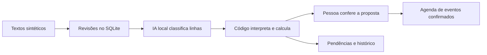
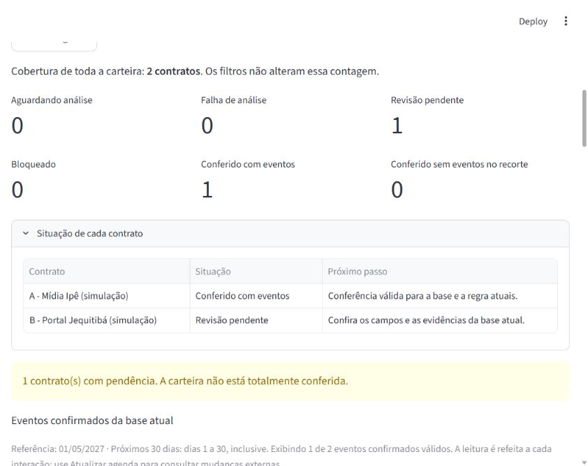

# Radar de Obrigações Contratuais

**Rascunho para revisão, ainda não pronto para submissão:** os links dos posts no LinkedIn e na comunidade estão vazios. Não foram publicados posts nem aberto PR para a galeria. Dados, personagens e decisões de negócio são sintéticos.

## O problema do case

Na Agência Prisma, Rafael Lima prepara os prazos dos fornecedores e Marina Costa confere antes de decidir. Uma planilha pode mostrar uma data de término e esconder que o aviso de não renovação precisa acontecer antes. Uma extração plausível também pode usar uma cláusula conflitante ou desatualizada.

O Radar organiza essa conferência. Ele distingue o texto de origem, a data calculada pelo código e o evento confirmado para a revisão atual. Não decide cancelar contratos ou enviar avisos.

## Como o fluxo funciona

Há também levantamento manual com evidências. Analisar, escolher um resultado e confirmar são ações separadas. Mudança de documento ou de resultado exige nova conferência; eventos antigos permanecem no histórico. Falhas e interrupções não são apresentadas como ausência de obrigações.

## Decisões de engenharia

- **Aplicação local modular:** Python, Streamlit e SQLite, com Alembic e SQLAlchemy. A transação mantém documentos, revisões, seleção e conferência coerentes no primeiro recorte local; escala distribuída ficou para uma proposta posterior.
- **IA sem autoridade de negócio:** Ollama e um modelo provisório de desenvolvimento classificam linhas. O código lê os literais, valida evidências e calcula as datas. Um formato estruturado não foi tratado como garantia de significado correto.
- **Histórico em vez de sobrescrita:** tentativas e resultados anteriores são preservados. Repetição idêntica não duplica eventos e resultado de base antiga não substitui a seleção atual.
- **Bloqueio explícito:** conflito, unidade não suportada e aditivo conhecido mantêm pendência. O sistema não inventa uma data para completar a lista.

## Harness e aprendizado

O Codex foi usado no desenvolvimento dentro de limites registrados em `AGENTS.md`, ADRs e checkpoint. Lucas define produto, riscos e orçamento e revisa os PRs; o agente não faz merge por autorização genérica para continuar.

Uma tentativa de melhorar o prompt regrediu outros casos. O resultado foi preservado, a referência anterior restaurada e as retenções passaram a ter revisão explícita. Esse foi um aprendizado do projeto: corrigir o exemplo que falhou não basta para escolher uma versão melhor.

## O que foi verificado

Em 02/11/2026, 371 testes passaram também numa cópia com ambiente e banco novos nesta máquina Windows. Os comandos documentados de preparo, validação e início foram exercitados. O segundo preparo criou backup e preservou todos os valores do banco isolado.

A referência automática teve 18/20 casos integrais no desenvolvimento conhecido, antes de correções. Houve demonstração da integração com o modelo local e revisão simulada; a reprodução adicional reutilizou o runtime instalado. Isso não é avaliação reservada ou revisão humana real de Lucas.

## Limites e como executar

Somente texto UTF-8 sintético e o recorte de término/aviso de não renovação. Sem OCR, consolidação de aditivos, autenticação, assinatura, cancelamento de inferência, envio de negócio ou operação de produção. Não foram medidos ganho de tempo ou desempenho sob carga.

O [repositório do projeto](https://github.com/LucasGoulartCouto/radar-obrigacoes-contratuais) contém discovery, PRD, SPEC, ADRs, arquitetura, código e evidências. Enquanto os PRs aguardam revisão, use a branch `codex/reproducao-e-entrega`; a `main` ainda não representa a aplicação funcional. Os comandos principais são `powershell -File scripts/Preparar-Ambiente.ps1`, `powershell -File scripts/Iniciar-Radar.ps1` e `powershell -File scripts/Validar-Projeto.ps1`.

Os PRs estão abertos para revisão, sem merge pelo agente. A escolha definitiva de IA e o planejamento de produção ficam para depois da aplicação e das decisões de Lucas.
