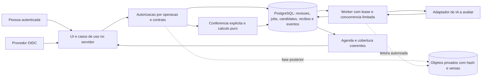

# M7 — proposta de evolução da arquitetura

Estudo de 05/11/2026, **aprovado por Lucas em 07/11/2026, com continuidade na versão local L**. [Registro do aceite](entrega/aceite-m7.md). Cenários continuam hipotéticos; sem metas reais de produção, orçamento, implantação ou modelo definitivo aprovados. Alternativas C/E abaixo ficam preservadas para decisões futuras.

**Recomendação:** manter a aplicação modular local para uso individual. Para uso compartilhado, experimentar o mesmo domínio/casos de uso com PostgreSQL central, identidade/autorização e worker separado. Começar com jobs no próprio banco. Adicionar objetos externos e broker quando requisito ou medição justificar.

Entrega: [baseline](validacao-m7.md), [custos](m7-custos.md), [ADR-014 aceito para L](adrs/014-evolucao-condicional-para-uso-compartilhado.md) e este plano. A [arquitetura atual](arquitetura.md) continua vigente; M7 não altera o código da aplicação nem migra seu banco.

## 1. Cenários e metas de estudo

Não há demanda real levantada para estes volumes. Sessões abertas não equivalem a operações simultâneas. Continuam os limites atuais de entrada; escala não amplia formatos ou suporte a aditivos.

| Aspecto | L: individual local | C: equipe centralizada | E: expansão exploratória |
|---|---|---|---|
| Carteira | 1.000 contratos | 10.000 contratos | 100.000 contratos |
| Pessoas / sessões abertas | 1 / 1 | 10 / 10 | 50 / 50 |
| Leituras de pico | 1/s | 2/s por 30 min | 10/s por 60 min |
| Confirmações de pico | 1 por vez | 0,5/s por 30 min | 2/s por 60 min |
| Análises | 20/dia útil | 100/dia útil, rajada de 20 | 1.000/dia útil, rajada de 100 |
| Histórico e documentos | 3 revisões/contrato, 2 documentos/revisão, média de 64 KiB/documento | Mesma hipótese | Mesma hipótese |
| Agenda e gravação | p95 ≤ 1 s nos serviços | p95 ≤ 1 s na fronteira da aplicação | p95 ≤ 1 s, sujeito a novo desenho de leitura |
| Extração | Medir separadamente | Aceitar solicitação p95 ≤ 1 s; iniciar p95 ≤ 60 s; concluir p95 ≤ 180 s, sem tempo humano | Redimensionar após medir modelo e concorrência |
| Recuperação | RPO ≤ 24 h / RTO ≤ 4 h | RPO ≤ 24 h / RTO ≤ 4 h no piloto | Estudar RPO ≤ 15 min / RTO ≤ 1 h |
| Disponibilidade | Durante a sessão local | Objetivo experimental 99,5% mensal | Objetivo experimental 99,9% mensal |

RPO é a perda máxima tolerada de dados; RTO é o tempo para recuperar. Esses objetivos exigem aceite e ensaio. Disponibilidade não foi medida; um nó web e um banco sem redundância não sustentam promessa de SLA. A revisão humana tem duração própria.

Originais em C: `10.000 × 3 × 2 × 64 KiB = 3,66 GiB`; em E: 36,62 GiB. Texto normalizado, índices, payloads e backups acrescentam espaço. São estimativas; o benchmark usa 8 KiB/documento e uma revisão, sem representar esse histórico inteiro.

**Invariantes:** zero eventos duplicados/parciais, zero confirmação sobre base/método antigos, cobertura integral, falhas visíveis e histórico preservado. Não afrouxar essas regras para atingir latência.

## 2. O que foi medido e o que motivaria mudança

O [ensaio](validacao-m7.md) usa 100/1.000/3.000 contratos, 1/4/8 threads e gravação concorrente. Em 3.000 contratos, p95 da agenda foi 87 ms com uma thread e 703 ms com oito. Não houve bloqueio nas operações medidas. A carga simplificada não prova C, capacidade máxima ou experiência de dez usuários remotos.

Na carga mista, a confirmação chegou a p95 de **2,352 s** em 3.000 contratos, acima da meta hipotética de 1 s, com máximo de 4,171 s. Isso exige perfil e comparação antes de promover uso concorrente. Não houve medição que isole locks, CPU ou I/O como causa única; PostgreSQL/WAL não foram ensaiados como correção.

A leitura atual materializa e classifica a carteira inteira. Perfil de SQL, criação de objetos e ordenação deve preceder otimização. Candidata: projeção com agregação/paginação, seis grupos e cobertura independente dos filtros no mesmo snapshot. Trocar apenas o banco não garante reduzir trabalho Python.

SQLite permanece adequado como ponto de partida para L; não houve saturação comprovada. WAL é alternativa a comparar, sem habilitação neste trabalho: permite sobrepor leitura/escrita, mantém um escritor e exige mesmo host. Não compartilhar arquivo pela rede. [SQLite: WAL](https://www.sqlite.org/wal.html).

## 3. Alternativas por componente

| Componente | Manter/otimizar | Evoluir se necessário | Gatilho e consequência |
|---|---|---|---|
| Aplicação | Python/Streamlit modular | Mesmo pacote + worker em outro processo | Processar após fechar a tela; novo ciclo de vida e recuperação |
| Banco | SQLite local e backups | PostgreSQL central | Acesso compartilhado e coordenação central; adaptar SQL/transações e migrar dados |
| Agenda | Consulta única atual | Agregação + paginação por cursor | p95/memória fora da meta; preservar ordenação/snapshot/cobertura |
| Originais | Bytes/texto no banco | Objetos privados com versão/hash | Tamanho, retenção ou recuperação justificam; coordenar vínculo e restauração |
| Jobs | Execução explícita local | Jobs transacionais com lease/token | Trabalho durável e concorrência limitada; job não seleciona/confirma |
| Mensageria | Jobs no PostgreSQL | Broker + outbox | Isolamento, volume ou consumidores justificam; deduplicação continua necessária |
| Identidade | Personagens locais | OIDC + autorização no servidor | Antes de acesso remoto; login/proxy sozinho não basta |
| IA | Adaptador local de desenvolvimento | Comparar máquina dedicada e API | Avaliação reservada, qualidade, contexto, custo e privacidade; sem modelo definitivo |

Microsserviços, Kubernetes, cache distribuído e banco analítico não atendem a um requisito demonstrado neste estudo. Reavaliar se aparecerem equipes independentes, consumidores ou perfis de carga que precisem disso. SQLAlchemy ajuda a separar responsabilidades, mas não garante migração automática.

## 4. Arquitetura do experimento C

Preservar `domain/`, `application/`, `infrastructure/` e `ui/`. UI e worker reutilizam casos de uso; domínio não importa PostgreSQL/OIDC/SDK de IA. No primeiro piloto, originais podem ficar no PostgreSQL, reduzindo mudanças simultâneas. Objetos e broker não são obrigatórios no primeiro corte.

1. Servidor valida identidade e permissão por operação/contrato, derivando responsável do identificador estável do provedor. `actor` digitado não comprova identidade. OIDC autentica; a política de autorização ainda precisa ser implementada. [Streamlit: autenticação](https://docs.streamlit.io/develop/concepts/connections/authentication).
2. Cadastro mantém origem, versões e hashes. Se objetos forem adotados, upload privado com hash verificado precede vínculo transacional; não confirmar antes do vínculo íntegro. Limpeza de órfãos respeita retenção e nunca remove objetos vinculados ao histórico.
3. Solicitar análise grava job/base/método na mesma transação. Worker reivindica job com lease e token crescente; encerra transação antes da IA. `FOR UPDATE SKIP LOCKED` é candidato para fila interna, não para pular contratos na agenda: sua leitura incompleta serve à seleção de trabalho. [PostgreSQL: SELECT](https://www.postgresql.org/docs/current/sql-select.html).
4. Conclusão só persiste se token/base/método forem válidos. Encerramento/reivindicação invalida token anterior. Rejeitar resultado tardio sem sobrescrever vigente. Persistir erro/incompleto sem inventar resultado vazio.
5. Seleção e confirmação continuam separadas. Confirmar compara revisão documental, seleção, execução, método, evidências e regra dentro da transação; grava recibo, revisão e eventos atomicamente. Usar comparação de versão e constraints únicas, sem confiar no estado da tela.
6. Contagens e página compartilham snapshot consistente. `READ COMMITTED` pode observar instantes diferentes entre comandos; escolher isolamento e testar conflitos. Retry de transação abortada deve ser limitado e idempotente, sem repetir IA. [PostgreSQL: isolamento](https://www.postgresql.org/docs/current/transaction-iso.html).

Recuperação automática mudaria a operação atual. No primeiro piloto proposto, lease vencido expõe tentativa incompleta e requer ação explícita para nova inferência. Automação futura precisa de política aprovada, teto de tentativas/custo e tratamento de resposta incerta. Não presumir cancelamento ou execução única da IA.

Se houver broker, gravar outbox com job e entregar após commit. Mensagem contém IDs, sem texto contratual; deduplicar por execução/recibo. [Outbox](https://docs.aws.amazon.com/prescriptive-guidance/latest/cloud-design-patterns/transactional-outbox.html) e [reentrega no SQS](https://docs.aws.amazon.com/AWSSimpleQueueService/latest/SQSDeveloperGuide/standard-queues-at-least-once-delivery.html) fundamentam mecanismos, sem demonstrar implementação no Radar.

## 5. Migração e reversão

| Fase | Evidência exigida | Avançar ou rejeitar |
|---|---|---|
| 0: decisão | Lucas escolhe cenário, metas, teto, identidade/dados e responsáveis | Sem isso manter L |
| 1: protótipo isolado | Adapter PostgreSQL, migrações novas, jobs e transações; testes de contrato nos dois bancos | Zero divergência de eventos/cobertura/versões |
| 2: comparação | Carga com histórico/textos do cenário, UI/rede, IA e falhas | Cumprir metas e invariantes, otimizar gargalo observado |
| 3: ensaio de corte | Backup consistente SQLite; importar cópia; comparar tabelas, bytes/hashes e projeções; restaurar em ambiente novo | Sem perda, duplicação ou normalização silenciosa |
| 4: piloto aprovado | Janela de manutenção, congelar escrita, importar/validar, trocar configuração, smoke crítico | Origem somente leitura; sem escrita dupla improvisada |
| 5: consolidação | Restore do destino, alarmes, operação e resultados do piloto | Só depois considerar objetos/broker/replicação |

Preservar IDs, bytes, `TEXT_REFERENCE_V1`, fingerprints, versões e payloads históricos. Comparar contagens e hashes canônicos de todas as linhas, além de eventos atuais. Datas/fusos, JSON, binários, constraints e recibos exigem ensaio específico. Não recalcular registros históricos nem recriar banco para migrar.

Antes de novas escritas no destino, voltar à origem é simples após conferência. Depois disso, apontar de volta ao SQLite perderia dados: parar escrita, capturar/reconciliar deltas com procedimento testado ou corrigir destino. Sem esse procedimento, reversão fica bloqueada. Ter backup original não resolve deltas novos.

Recuperação C: cópia consistente diária, retenção de estudo 7 diárias/4 semanais, destino separado e acesso restrito; ensaio mensal restaurando banco e objetos no mesmo ponto lógico. Para E, avaliar PITR/logs do banco e objetos versionados para RPO de 15 min. RPO/RTO só comprovados em restauração medida. Recuperar job não seleciona/confirma resultado.

## 6. Operação, identidade e custos

O [modelo de custos](m7-custos.md) registra catálogo, fórmulas, exclusões e sensibilidade da IA. Subtotal não é orçamento completo nem comprovação de capacidade.

| Sinal | Limite inicial proposto / ação | Responsável a designar |
|---|---|---|
| Agenda/gravação | p95 > 1 s em 5 min, com volume mínimo; examinar SQL/CPU/projeção | Mantenedor |
| Falha/ocupação | > 1% em 5 min ou qualquer violação de integridade; suspender confirmação se integridade incerta | Mantenedor + responsável pelos dados |
| Jobs | Mais antigo > 60 s, lease vencido ou backlog crescente; limitar entrada/recuperar explicitamente | Operação |
| IA | Timeout, tokens/custo, retenções, método/digest; separar espera/inferência/persistência | Responsável pela IA |
| Backup | Último sucesso > 24 h, falha de restore ou objeto ausente | Operação do banco |
| Custo | Alertas em 50/80% do teto aprovado; no teto bloquear novas extrações e preservar leitura/manual | Lucas aprova teto; operação aplica |

Logs técnicos guardam correlação, duração, código sanitizado e versão, sem texto contratual, credenciais ou dados pessoais. Restringir também IDs correlacionáveis; definir acesso/retenção. Histórico de negócio separado, com identidade e autorização reais; proteção administrativa requer desenho próprio, sem chamar o histórico atual de inviolável. Segredos e backups protegidos, privilégios mínimos por serviço.

Antes do acesso remoto: testar negação por ação/contrato, revogação, URL direta de objetos, TLS, sessão, limites de upload e ausência de texto em logs. Worker propõe; não recebe permissão de confirmar nem enviar mensagens externas. Multiempresa não está implícita: exigiria chave de escopo em relações/consultas e testes de acesso cruzado.

## 7. Gates de carga e correção do destino

O medidor M7 é baseline de serviços, não aceitação do destino.

| Ensaio | Método | Aceite/rejeição |
|---|---|---|
| Carga C | 10.000 contratos/3 revisões/2 docs de 64 KiB; 30 min, 2 leituras/s e 0,5 confirmação/s; gerador externo por taxa de chegada | p95 ≤ 1 s, erro técnico < 1%, backlog estável; guardar p99/máximo e atraso de chegada |
| Rajada + IA | 20 solicitações simultâneas, extrator real avaliado, depois 100/dia simulado | 95% iniciam ≤ 60 s e concluem ≤ 180 s; custo no teto; sem seleção/confirmação automática |
| Conflitos | Mesmo recibo, edições concorrentes, documento/método novo durante IA, resultado tardio | Um efeito por recibo, base antiga rejeitada, cobertura completa, zero evento parcial |
| Falhas | Interromper worker antes/depois de claim/commit, timeout de IA, perder conexão, duplicar/reordenar mensagem se existir broker | Incompleto visível, token antigo rejeitado, sem repetir IA silenciosamente |
| Restore/originais | Upload interrompido, hash divergente, objeto ausente; restore completo novo | Bloquear confirmação inválida, preservar versões/relações dentro de RPO/RTO medidos |
| Identidade | Sem permissão, revogação, URL direta, identidade adulterada | Negação no servidor; sem leitura/escrita indevida ou autoria digitada como confiável |
| Expansão/saturação | Aumentar carteira/taxa até romper meta, sustentado 8 h e recuperação | Identificar limite/backpressure; não promover E se só C passou |

Gerador futuro agenda chegadas independentemente da conclusão. Threads em ciclo fechado no baseline podem subestimar esperas em saturação. Registrar ambiente, versões, tamanhos, repetições, CPU/RAM/I/O, SQL, falhas, distribuições e estado final. Não colocar limiar instável de tempo na CI funcional; CI executa smoke/invariantes, carga longa é explícita e isolada.

Dimensionamento da IA: utilização aproximada `λ × t / k`, com taxa de chegada `λ`, duração média `t` e slots `k`. Com 20 chamadas em rajada e `t = 15 s` hipotéticos, um slot levaria ~300 s para terminar todas; quatro slots ~75 s antes de overhead. Média não comprova p95; paralelismo pode degradar o modelo. Medir antes de escolher slots ou prometer prazo.

## 8. Continuidade decidida em 07/11/2026

Lucas aprovou o estudo e escolheu manter L, conforme o [aceite](entrega/aceite-m7.md). O [ADR-014](adrs/014-evolucao-condicional-para-uso-compartilhado.md) está aceito para esse direcionamento. Protótipo C fica adiado. Caso seja escolhido futuramente, adaptar/verificar PostgreSQL, jobs e autorização em teste antes de contratar hospedagem. Modelo, fornecedor, região, teto, retenção e operação remotos continuam abertos. M7 entrega estudo; capacidade remota e controles operacionais continuam sem comprovação.
