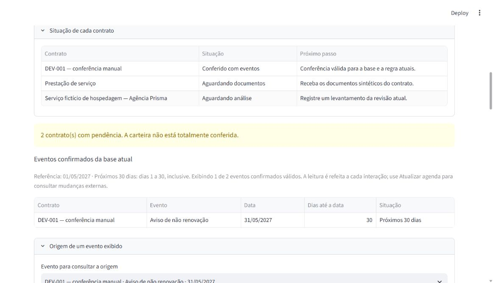

# Validação da agenda e cobertura

01/11/2026 · Case sintético da Agência Prisma · branch `feat/agenda-e-cobertura`, dependente de `feat/candidatos-e-conferencia`.

## Resultado e escopo

A agenda consulta somente confirmações válidas para a base atual e mostra a cobertura de todos os contratos, inclusive pendências e resultados vazios conferidos. Referência e filtros mudam a visualização sem escrever no banco. Decisão de implementação no [ADR-008](adrs/008-agenda-e-cobertura-da-carteira.md).

**165 testes locais aprovados:** 123 anteriores e 42 novos, sendo 24 de domínio, 11 de integração e 7 de interface. O total inclui parametrizações; não é percentual de cobertura. A CI do commit publicado deve ser conferida no PR e vinculada ao seu HEAD antes de declarar aprovação remota.

## Matriz por funcionalidade criada ou alterada

Os links abaixo apontam para os testes desta branch. A descrição do PR deve fixar os links no commit auditado e indicar a execução correspondente.

| Funcionalidade | Cenário e resultado esperado verificado | Testes/evidência |
|---|---|---|
| Classificação temporal (RF-07/C19) | 30/04, 01/05, 31/05 e 01/06 em relação a 01/05/2027 pertencem a grupos exclusivos; datas passadas continuam disponíveis | [Domínio: test_agenda_classifies_spec_boundaries_without_losing_past_events](../tests/unit/test_agenda.py), [fluxo confirmado: test_confirmed_notices_reach_all_four_temporal_groups_and_keep_equal_dates_separate](../tests/integration/test_agenda.py) |
| Filtros, ordenação e tipos | Filtrar período/tipo não muda cobertura; filtro vazio não significa todos; término e aviso na mesma data permanecem separados; desempate é estável | [test_temporal_and_kind_filters_do_not_change_portfolio_coverage e test_date_order_ties_and_two_kinds_on_same_date_are_deterministic](../tests/unit/test_agenda.py), [test_empty_filters_do_not_remove_coverage_or_hide_pending_warning](../tests/scenarios/test_agenda_ui.py) |
| Referência de simulação | Mudar referência altera só a visão; datas extremas não transbordam; inválidas são rejeitadas; apagar referência mantém cobertura e nova sessão retorna a 01/05/2027 | [test_reference_changes_only_the_view_and_supports_date_extremes e test_reference_requires_date_without_time](../tests/unit/test_agenda.py), [test_kind_and_temporal_filters_change_view_but_reference_never_changes_confirmation e test_missing_reference_keeps_portfolio_visible_without_inventing_a_date](../tests/scenarios/test_agenda_ui.py) |
| Cobertura completa e vazios (RF-07, parte de C20) | Todos os contratos atuais são contados uma vez em seis situações; vazio conferido difere de pendência; carteira vazia tem seis zeros | [test_coverage_is_exclusive_and_blocks_incomplete_confirmation e test_empty_portfolio_has_all_zero_counts](../tests/unit/test_agenda.py), [test_mixed_portfolio_counts_every_contract_once_and_only_emits_current_reviewed_events](../tests/integration/test_agenda.py), [test_agenda_shows_current_notice_evidence_and_all_pending_contracts](../tests/scenarios/test_agenda_ui.py) |
| Elegibilidade, reconferência e histórico (RF-05/06, C11/12/21) | Alteração documental, regra, resultado ou retirada remove evento da agenda, preserva contrato/histórico e replay não reativa; aditivo continua bloqueado | [test_changed_base_disappears_from_agenda_without_hiding_contract_or_deleting_history e test_known_amendment_stays_blocked_after_removal](../tests/integration/test_agenda.py), [test_refresh_removes_stale_event_keeps_contract_and_previous_review_visible](../tests/scenarios/test_agenda_ui.py) |
| Confirmação inconsistente | Falta de um evento retira o conjunto inteiro da agenda e sinaliza revisão pendente | [test_partial_confirmation_is_pending_and_no_partial_event_is_published](../tests/integration/test_agenda.py) |
| Leitura consistente e sem escrita | Uma única SELECT usa metadados, sem bytes/texto/payload da carteira; mudar referência/filtros conserva contagens de todas as tabelas | [test_read_is_single_metadata_select_and_reference_filters_never_write](../tests/integration/test_agenda.py) |
| Erro de consulta | Banco ocupado ou falha de leitura gera erro útil; interface não mostra cobertura zero e continua oferecendo acesso ao contrato | [test_failed_read_reports_unavailable_instead_of_empty_or_reviewed_portfolio](../tests/integration/test_agenda.py), [test_failed_portfolio_read_shows_error_without_zero_coverage](../tests/scenarios/test_agenda_ui.py) |
| Origem do evento | Mostrar evidência, cálculo e conferência do evento escolhido; mudança entre projeção e origem produz alerta | [test_agenda_shows_current_notice_evidence_and_all_pending_contracts e test_source_warns_if_base_changes_after_portfolio_read](../tests/scenarios/test_agenda_ui.py), demonstração abaixo |
| Integração da tela e regressões | Cadastro, documentos e conferência anteriores continuam funcionando após a inclusão da agenda | [testes de cadastro](../tests/scenarios/test_foundation_ui.py), [documentos](../tests/scenarios/test_documents_ui.py) e [conferência](../tests/scenarios/test_reviews_ui.py), todos incluídos nos 165 testes |

Os testes também rejeitam filtros não suportados e referência com horário. A inspeção dos links dos testes e a CI são evidências complementares: adequação semântica da matriz continua tarefa de revisão.

## Demonstração real no navegador

Usado o banco local já existente, com três contratos, sem criar/editar cadastros ou registrar nova conferência durante esta demonstração. A conferência do DEV-001 havia sido **simulada pelo agente** na etapa anterior.

1. Referência inicial 01/05/2027: aviso em 31/05/2027 aparece como próximos 30 dias; o término posterior ao horizonte fica acessível ao ampliar o filtro.
2. Cobertura: três contratos, sendo um aguardando documentos, um aguardando análise e um conferido com eventos. Alerta explícito de duas pendências.
3. Limpar situações de prazo: nenhum evento exibido, mantendo os três contratos, métricas e alerta.
4. Simular 30/06/2027: aviso em 31/05 fica com −30 dias/data ultrapassada; término em 30/06 fica como hoje, com zero dias.
5. Filtrar término: um de dois eventos válidos exibido; cobertura permanece igual.
6. Recarregar: referência volta ao padrão; consultar origem mostra revisão 1, levantamento 1, personagem Marina e os trechos das linhas 5/6, com cálculo 30/06/2027 − 30 dias = 31/05/2027.



Os quatro grupos completos, retirada por mudança da base, inconsistência, erro de leitura e concorrência entre projeção/origem foram verificados em testes; não foram repetidos todos manualmente no navegador. A interface foi aberta após reiniciar o servidor local para carregar os novos módulos; não houve migração nem recriação do banco.

## Reprodução

```powershell
uv run --locked pytest --verbose
uv run --locked ruff check .
uv run --locked ruff format --check .
uv run --locked python scripts/check_docs.py
uv lock --check
uv pip check
```

Na execução local, testes usaram `.tools/test-temp`, com permissão para conexões locais do AppTest. Ruff, formatação, lock e compatibilidade dos 44 pacotes também passaram. Os artefatos locais e logs ficam fora do Git. A CI da publicação deve ser verificada separadamente no PR.

Wheel e distribuição fonte foram construídos e inspecionados: os quatro módulos da agenda e o registro de validação estão incluídos, sem banco, caches ou ferramentas locais no arquivo fonte. O wheel foi reinstalado em `.tools/repro` e consultou o banco existente com três contratos e dois eventos válidos, sem importar o checkout nem alterar o esquema. Esse segundo ambiente reutiliza dependências e não equivale a uma execução em outro computador.

## Limites

Não há extrator, estado de falha de análise persistido, integração para avisos externos, ação de cancelamento, autenticação ou auditoria inviolável. C19 está exercitado na consulta; C20 completo continua pendente das situações de execução do futuro extrator. A cobertura aqui possui as seis situações alcançáveis no caminho manual, incluindo aguardando documentos; não simula uma falha de extração inexistente.

A consulta completa de metadados em memória atende a esta implementação local, sem capacidade máxima ou desempenho sob carga medidos. Leitura é uma fotografia consistente; mudanças externas exigem atualização. Os filtros não declaram obrigações cumpridas ou descumpridas. Não houve revisão humana real por Lucas, avaliação de extração ou encerramento de toda a SPEC.
