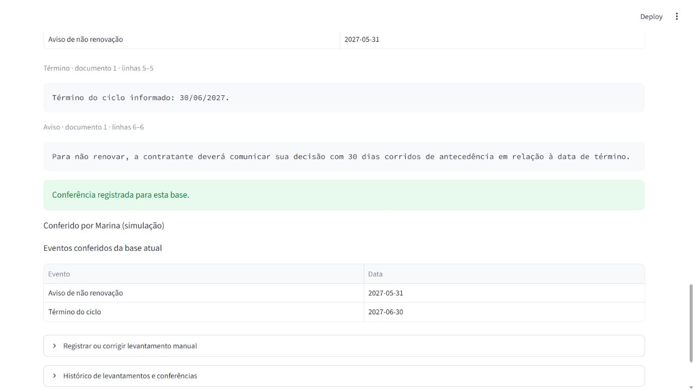

# Validação de candidatos e conferência manual

01/11/2026 · Case sintético da Agência Prisma · branch `feat/candidatos-e-conferencia`.

## Resultado local

**123 testes passaram localmente:** 81 anteriores e 42 novos, sendo 24 de domínio, 15 de persistência/migração e 3 de interface. Ruff passou. A [CI do commit funcional 3d470fb](https://github.com/LucasGoulartCouto/radar-obrigacoes-contratuais/actions/runs/41318794275) também passou em Windows e Linux, incluindo testes, Ruff, lock, dependências e links locais. A entrega está no [PR #4](https://github.com/LucasGoulartCouto/radar-obrigacoes-contratuais/pull/4); atualizações documentais posteriores exigem conferir a CI do novo HEAD.

As verificações novas incluem:

- Oito casos anotados usados como referência da entrada manual, sem alegação de extração automática.
- Rejeição de citação inexistente, linhas inválidas, origem incompatível e campos inválidos.
- Cálculo de aviso, ano bissexto, prazo zero, unidade/âncora não suportadas e impedimento declarado.
- Candidatos fora da lista de eventos conferidos até uma confirmação separada.
- Correção com justificativa, preservação do original e nova conferência para resultado diferente.
- Reenvio idempotente, concorrência, resultado equivalente e recibo antigo sem reativação de eventos.
- Mudança de documento ou regra invalidando a visão atual, sem apagar conferência histórica.
- Resultado vazio com declaração própria, separação entre contratos e bloqueio por aditivo conhecido.
- Falha no histórico revertendo conferência, eventos e recibo; recuperação com a mesma operação.
- Migração desde `0002_documents` com bytes/recibos existentes e restauração de backup com eventos conferidos.

O teste sobre evidência literal sem suporte semântico documenta um limite: localizar a frase não prova que o campo está correto. A revisão de significado continua sendo tarefa da conferência. Não foi medida uma taxa de acerto de extração.

Wheel e distribuição fonte foram gerados e inspecionados: a migração 0003 e a interface estão incluídas, sem banco ou ferramentas locais. O wheel foi reinstalado em um segundo ambiente do projeto; banco novo, candidatos e conferência passaram sem importar o checkout. As dependências desse ambiente foram reutilizadas; isso não é uma execução em outro computador.

## Migração do banco local

Antes da atualização para `0003_reviews`, foi criado um backup consistente em `var/backups/`. Foram comparadas **todas as linhas anteriores**, incluindo os bytes dos arquivos, nas cinco tabelas já existentes. Permaneceram iguais: 2 contratos, 6 recibos, 5 eventos de histórico, 2 revisões documentais e 3 arquivos recebidos. Integridade referencial conferida. Os dados anteriores não foram recriados.

## Demonstração real no navegador

1. Criado o cadastro sintético `DEV-001 — conferência manual`, sem alterar os cadastros anteriores.
2. Enviado o documento DEV-001 e registrado o término 30/06/2027 com evidência na linha 5, além de antecedência de 30 dias corridos com evidência na linha 6.
3. Salvo o levantamento: o banco continha os candidatos 30/06/2027 e 31/05/2027 e **nenhuma conferência** para esse levantamento.
4. A tentativa de confirmar sem a declaração de conferência foi rejeitada pela interface.
5. Registrada a conferência **simulada pelo agente**, com o personagem Marina. Os dois eventos passaram a aparecer na visão da base atual.
6. Página recarregada e contrato selecionado novamente: conferência e datas permaneceram disponíveis. A leitura pelo serviço confirmou a mesma base e os dois eventos.

A invalidação por mudança documental/regra e a concorrência foram verificadas nos testes de integração e AppTest; não foram repetidas manualmente nessa demonstração do navegador.

## Alcance e limitações

Esta entrega cobre o caminho manual de evidência, cálculo e conferência. Não implementa extrator automático, estados de execução de um extrator, agenda temporal completa, autenticação ou assinatura. Não há prova de revisão humana real de Lucas, desempenho sob carga ou auditoria inviolável. O papel dos documentos e os impedimentos semânticos ainda dependem de informação e conferência do operador.

As decisões estão no [ADR-007](adrs/007-levantamento-manual-e-conferencia.md). A [SPEC](specs/001-primeiro-fluxo.md) continua sendo a referência dos cenários completos; testes desta etapa não devem ser apresentados como cobertura automática de toda a SPEC.
