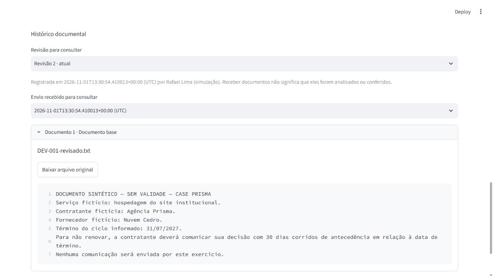

# Validação da entrada documental

01/11/2026 · Documentos sintéticos da Agência Prisma. Implementação na branch `feat/entrada-documental`, dependente da entrega de regras e casos. Os PRs anteriores continuam separados para revisão; este registro não representa aprovação humana ou integração na principal.

## Comportamentos implementados

- Entrada de conjuntos `.txt` UTF-8 com papel declarado, limites e rejeição de entrada inválida.
- Originais preservados em bytes, texto de referência e revisões anteriores disponíveis.
- Reenvio equivalente mantém a revisão; alteração de texto/papel/conjunto cria outra.
- Recibo idempotente, histórico e revisão gravados atomicamente; tela desatualizada exige atualização.
- Histórico permite escolher revisão e envio, ler o texto com linhas e baixar o original daquele envio.
- Aditivo declarado no histórico mantém a sinalização de bloqueio; não há análise automática de seu conteúdo.

## Testes

**81 testes passaram localmente:** 43 anteriores e 38 desta entrega (21 de entrada/configuração, 14 de persistência/migração e 3 de interface). Ruff, formatação, consistência do lock e dos 44 pacotes e verificação dos links locais também passaram.

As verificações novas cobrem limites em bytes, UTF-8/BOM/quebras de linha, rejeição de conteúdo inválido, identidade do conjunto, preservação de originais, recibos repetidos, mudança de revisão, concorrência, falha no histórico e recuperação, separação entre contratos, retirada explícita, aditivo conhecido, backup e evolução desde `0001_foundation`.

A migração é exercitada a partir de um banco com contrato, recibo e histórico já preenchidos. Após a atualização e sua repetição, os dados permanecem e a nova entrada funciona. Os testes de interface verificam persistência, alerta de aditivo e bloqueio de tela desatualizada. O upload e o download reais foram verificados separadamente no navegador.

O total final e as verificações executadas constam na descrição do PR desta entrega. Testes da entrada não substituem os cenários completos de revisão, confirmação ou agenda.

O wheel e a distribuição fonte foram gerados. A inspeção confirmou a inclusão da migração `0002_documents` e a ausência de banco, cache e ferramentas locais na distribuição fonte. O wheel foi reinstalado num segundo ambiente isolado do projeto; criação do banco e envio/leitura de documento preservando os bytes passaram sem importar o código do checkout. Essa execução reutilizou as dependências já instaladas e não equivale a uma instalação em outro computador.

## Banco local já existente

Foi criado um backup consistente antes de atualizar `var/radar.sqlite3`. Antes e depois da migração havia **1 contrato, 1 recibo e 1 evento de histórico**, com integridade referencial conferida. Não foi recriado o banco. O backup permanece em `var/backups/`, fora do Git.

## Operações reais no navegador

1. Enviado `DEV-001-base.txt` pela interface: revisão 1 criada e preservada após recarregar.
2. Reenviado o mesmo conjunto: revisão 1 mantida, com recibo próprio e nenhum novo evento de revisão.
3. Substituído o texto por uma variante sintética com término em 31/07/2027: revisão 2 criada, mantendo a revisão 1 acessível.
4. Tentativa com **262.145 bytes**: rejeição explícita, sem alteração da revisão atual ou persistência do arquivo.
5. Original da revisão 2 baixado pela interface: **417 bytes**, iguais ao arquivo enviado. SHA-256 `4a326b7c6af0804d03cc804f748fbfc990538b01b625100dda1f83de4e421660`.

Após as operações aceitas: **2 revisões e 3 arquivos recebidos**. A consulta do banco confirmou que o arquivo acima do limite não foi persistido.

## Alcance dos cenários da SPEC

C08/C09 têm verificações da entrada sem duplicação de revisão e da separação entre contratos. C18 tem rejeição por limites com base anterior preservada. C10 tem sinalização de aditivo declarado; a detecção textual e a tentativa de confirmar continuam sem implementação. A mudança documental é versionada, mas C11/C12 completos ainda dependem da futura conferência e de seus eventos.

## Limitações

Não há extrator, execução de análise, confirmação ou agenda. Receber um documento não o torna conferido. A identificação do responsável é uma informação da simulação, sem autenticação. O histórico lógico e os hashes não tornam o banco local inviolável. Não houve teste de carga nem comprovação de uso em produção.

Detalhes e consequências estão no [ADR-006](adrs/006-entrada-e-revisoes-documentais.md).
