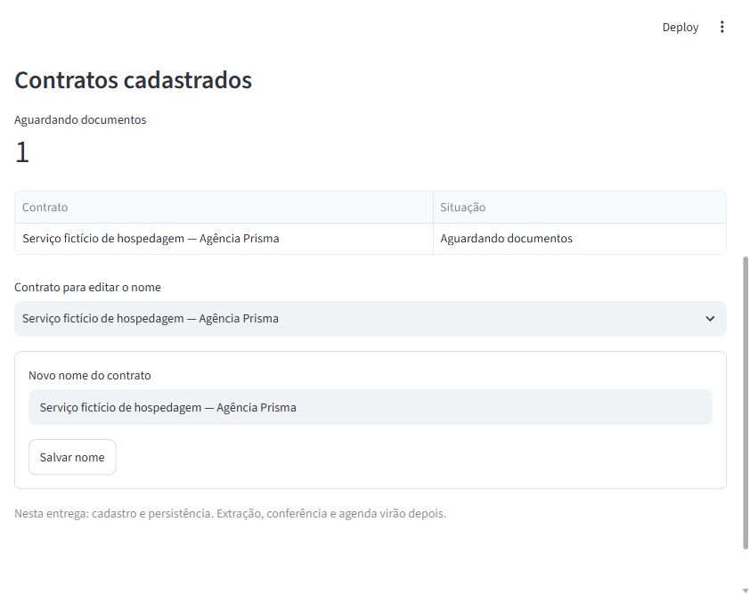

# Validação da fundação

Execução local em 01/11/2026, no Windows. Este registro descreve verificações efetivamente realizadas; não comprova operação do produto completo nem comportamento em produção.

## 1. Ambiente efetivamente utilizado

| Componente | Versão |
|---|---|
| Python | 3.14.3 |
| SQLite fornecido pelo interpretador | 3.50.4 |
| uv de bootstrap | 0.13.6 |
| Streamlit | 1.66.1 |
| SQLAlchemy | 2.1.6 |
| Alembic | 1.20.1 |
| pytest | 9.2.0 |
| Ruff | 0.17.3 |

As dependências foram resolvidas a partir do índice público PyPI e fixadas em `uv.lock`. O ambiente de execução está em `.venv`, e o uv de bootstrap está separado em `.tools/bootstrap`. Não foram instalados pacotes no Python global do usuário.

## 2. Resultados

| Verificação | Resultado e alcance |
|---|---|
| Testes automatizados | **34 passaram**: 14 de datas, 16 de persistência/validação e 4 de interface via AppTest |
| Código e formatação | Ruff sem erros; formatação conferida |
| Dependências | `uv pip check` informou compatibilidade entre os 44 pacotes instalados |
| Esquema | Migração inicial aplicada; repetição com dados preservada; versão de esquema verificada |
| Atomicidade | Falha provocada no histórico desfez cadastro e recibo de operação na mesma transação |
| Reenvio | Mesma identificação/conteúdo retornou o recibo anterior sem duplicar cadastro/histórico; conteúdo diferente foi rejeitado |
| Edição desatualizada | Versão antiga não substituiu uma edição posterior; o cenário foi verificado no armazenamento e na interface |
| Edições concorrentes | Duas tentativas sobre a mesma versão produziram uma única atualização aceita |
| Persistência | Cadastro conservado ao fechar/reabrir o banco e ao abrir uma nova sessão de interface |
| Backup/restauração | Backup consistente restaurado para outro arquivo, com dados e versão de esquema conferidos |
| Pacote | Fonte e wheel construídos; migração incluída; ferramentas, ambientes, caches e `var/` ausentes do arquivo fonte |
| Segunda instalação | Novo ambiente em `.tools/repro`, sincronizado do mesmo lock/cache; wheel instalado e migração executada com recursos do pacote instalado |
| Navegador real | Servidor local respondeu HTTP 200; cadastro fictício criado pela interface e mantido após recarregar |

A soma de testes conta casos parametrizados, não funcionalidades independentes. A segunda instalação utilizou o cache local; não equivale a teste em outro computador ou em outro sistema operacional.



## 3. Comandos principais

```powershell
.\scripts\Validar-Projeto.ps1
.\.tools\bootstrap\Scripts\uv.exe build
.\.tools\bootstrap\Scripts\uv.exe run --locked radar init-db
```

Nesta sessão, a pasta temporária dos testes foi direcionada para `.tools/test-temp`. O primeiro teste de interface esbarrou na restrição a conexões locais do ambiente de execução; foi refeito com a permissão correspondente, sem mudar o comportamento do aplicativo para contornar a restrição. O limite de espera do AppTest é de 30 segundos para acomodar inicialização; não é uma meta de desempenho da aplicação.

## 4. O que estes resultados não comprovam

- Deduplicação de documentos, resolução de revisões documentais ou validação semântica de evidências: ainda não implementadas.
- Extração de candidatos, confirmação de obrigações e agenda: ainda não implementadas.
- Cobertura dos 22 cenários completos da SPEC: testes de datas verificam partes dos exemplos C01–C04 e C19; testes de cadastro não substituem os cenários documentais C08/C12/C17.
- Evolução entre versões diferentes de esquema: a verificação atual cobre criação e reexecução da migração inicial com dados. A primeira migração evolutiva deverá ter teste próprio de preservação.
- CI no GitHub, proteção da principal ou bloqueio real de merge: arquivos preparados, operação remota pendente.
- Linux: previsto na matriz de CI, ainda sem execução comprovada.
- Desempenho sob carga, segurança de produção, identidade autenticada ou auditoria inviolável.

O cadastro usa uma versão de registro para controlar edições de nome. Essa versão não deve ser apresentada como revisão documental de contrato. O nome informado como revisor/operador é um identificador da simulação, não prova de autenticação.
