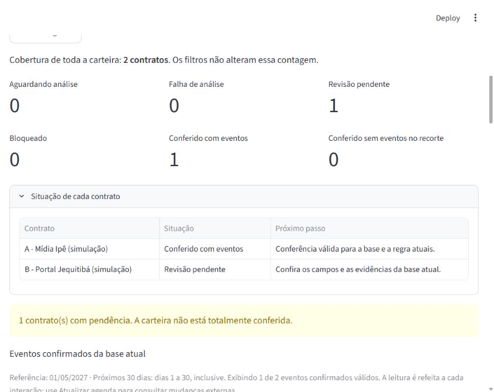

# Validação da integração assistida local

02/11/2026. Branch `codex/extracao-assistida`, base `5db8bf849c4799b3f1b0854d9781480475f447f4` (PR #10). [PR #11](https://github.com/LucasGoulartCouto/radar-obrigacoes-contratuais/pull/11) publicado em rascunho, snapshot funcional `efc3033f01ec26b50bb4cdf93a40849c1d068787`; árvore `8183c226bbea286345c9c8c6bb59a54c452c23b0` comparada ao índice local. [ADR-013](adrs/013-execucao-e-conferencia-assistidas.md). Descrição do PR mantém HEAD/CI finais após este fechamento documental. Testes, execução do modelo e revisão real de Lucas são evidências distintas. Nenhum merge.

## Resultado implementado

Tentativas persistidas e disputa de execução única, inferência fora da transação, seleção explícita de resultado, revisão restrita de contexto na tela e confirmação separada. `ASSISTED_LOCAL_LINES_V1` preserva a origem assistida; interpretação/prompt V1 anteriores intactos. Falhas, abstenções e interrupções não viram vazio. Resultado desatualizado permanece no histórico, sem substituir a base atual. Repetição idêntica conserva a conferência, sem duplicar eventos.

O adaptador usa loopback e o mesmo modelo provisório fixado por digest. Compartilha orçamento de 120 s entre requisições locais e não faz retry automático. Não cancela o cálculo do runtime ao encerrar um registro. Excesso de contexto é rejeitado antes da reserva, sem truncamento. Aditivo declarado ou declaração textual afirmativa reconhecida permanece conhecido mesmo após retirada do arquivo.

## Matriz por comportamento

**Versão final local: 371 testes aprovados (52 novos), Ruff/formatação, lock/dependências e 47 arquivos/323 links locais aprovados.** A suíte final terminou em 19,50 s, incluindo os cenários de tela com os recursos locais necessários. CI remota ainda será conferida no PR. Pacotes wheel/fonte construídos e inspecionados: migração 0004 e módulos novos presentes; sem ferramentas, cache ou banco. A primeira construção tentou consultar o índice sem acesso a DNS; a construção offline reutilizou o cache existente e concluiu, sem alterar dependências.

Suíte com bancos temporários em arquivo e inferência simulada. Testes de persistência em [test_extractions.py](../tests/integration/test_extractions.py); os nomes abaixo identificam cenários inspecionáveis.

| Funcionalidade | Cenário/resultado esperado | Evidência |
|---|---|---|
| Reserva → confirmação | Reservar antes de enviar; inferir uma vez; escolher não confirma; confirmar publica dois eventos | `test_reservation_execution_selection_and_confirmation_are_separate` |
| Idempotência/disputa | Repetição não duplica; outro conteúdo com mesmo ID é rejeitado; só um executor envia | `test_same_operation_with_other_inputs_is_rejected`, `test_only_one_worker_can_claim_a_pending_attempt` |
| Reexecução idêntica | Preservar tentativa adicional, seleção e conferência, sem novos eventos | `test_identical_new_attempt_reuses_confirmed_analysis_without_duplicate_events` |
| Falha/abstenção/vazio | Falha visível; abstenção bloqueada; vazio exige declaração específica | Testes `test_failure_has_coverage_and_does_not_log_document_or_become_empty`, `test_abstention_is_blocked_instead_of_empty_success`, `test_empty_result_requires_separate_empty_acknowledgment` |
| Recuperação | Encerramento explícito; nova tentativa; resposta tardia não publica | `test_incomplete_attempt_needs_explicit_interrupt_and_cannot_execute_again`, `test_interrupted_worker_cannot_publish_late_result` |
| Base concorrente | Escrita documental no callback prova rede fora da escrita; resultado antigo fica no histórico | `test_document_change_during_inference_keeps_old_result_without_selecting` |
| Seleção/método alterados | Resultado tardio não substitui manual; método alterado rejeita seleção/confirmação | `test_manual_selection_during_inference_rejects_late_assisted_selection`, `test_changed_method_prevents_selection_and_confirmation` |
| Invalidação | Nova revisão retira eventos somente da visão atual; tentativa não selecionada falha não desfaz conferência | `test_confirmed_source_change_removes_only_current_events`, `test_failure_of_unselected_new_attempt_keeps_valid_confirmation` |
| Retenções na aplicação | Preservar original/correção e exigir reconferência | `test_context_review_is_persisted_and_requires_reconfirmation` e cenário de tela |
| Aditivo textual/histórico | Retirada não libera; reconhecimento antes de inferência que falha também bloqueia | `test_textual_amendment_remains_known_after_document_removal`, `test_amendment_identified_before_a_failed_inference_remains_blocked` |
| Escrita interrompida | Conclusão falha deixa tentativa recuperável; confirmação falha não grava parte dos eventos | `test_finish_failure_leaves_attempt_recoverable_without_empty_result`, `test_confirm_failure_rolls_back_review_and_all_events` |
| Limites/formato/armazenamento | Excesso não reserva/envia; saída incompleta vira falha; disputa com erro mantém pendência sem exibir SQL | Testes `test_excess_input_is_rejected_before_reserving_or_sending`, `test_invalid_output_coverage_fails_instead_of_persisting_empty`, `test_failed_claim_preserves_pending_attempt_and_reports_safe_error` |
| Adaptador | Validar sem rede; devolver classificações; compartilhar orçamento; recusar digest diferente antes de inferir | [test_local_classifier.py](../tests/unit/test_local_classifier.py), três testes |
| Referência V1 | Reproduzir candidatos das 20 observações salvas sem correções humanas; rejeitar normalizador/entrada inválidos | [test_assisted.py](../tests/unit/test_assisted.py), 21 testes |
| Migração | Preservar todos os valores das tabelas anteriores e a conferência válida | `test_migration_from_manual_schema_preserves_every_legacy_value` e migração real abaixo |
| Seis grupos | Uma situação por contrato, total fecha com carteira, apenas eventos atuais; leitura única de metadados | `test_mixed_portfolio_counts_every_contract_once_and_only_emits_current_reviewed_events` em [test_agenda.py](../tests/integration/test_agenda.py) |
| Interface | Fluxo completo, recarga sem inferência, falha/recuperação, retenção e interrupção | [test_extractions_ui.py](../tests/scenarios/test_extractions_ui.py), quatro cenários |

O replay de 20 observações não executa o modelo nem é avaliação independente. A disputa concorrente inicialmente revelou leitura antes da escrita condicional, causando bloqueio na promoção da transação SQLite; a tomada da tentativa passou a escrever condicionalmente antes de ler. O cenário concorrente passou depois da correção. A tela diferencia resultado original da tentativa e correção de contexto registrada.

## Migração real e operação

Backup consistente antes de 0003 → 0004. Comparadas **todas as colunas anteriores e todas as linhas** das oito tabelas: 3 contratos, 10 recibos, 9 registros de histórico, 3 revisões, 4 documentos recebidos, 1 levantamento, 1 conferência e 2 eventos. Nenhum valor anterior mudou. A consulta posterior manteve **3 contratos e 2 eventos vigentes**. Banco/backups fora do Git; [registro sanitizado](evidencias/integracao-assistida-local.json) identifica backup/contagens. O teste de migração usa outro banco temporário.

O preparo cria backup ao encontrar banco existente. O início reutiliza metadados locais do modelo ou `RADAR_LOCAL_MODEL_DIGEST`. Scripts Windows em UTF-8 com BOM; parser PowerShell verificou ambos sem erros de sintaxe. Pacotes inspecionados conforme registro acima; os wrappers completos de primeira instalação/início ainda não foram repetidos numa máquina limpa. O servidor da demonstração foi iniciado diretamente com a mesma configuração explícita.

## Demonstração real pelo navegador

Ollama 0.40.13, mesmo Qwen3 4B Instruct Q4, digest `0edcdef34593eac1aa2be9c7d06c432dcf81945adca5eca2f27662c18f168ba0`. Banco isolado em `.tools/demo-assistida`, interface na porta 8502. Os dois cadastros sintéticos e documentos foram preparados pelos serviços da aplicação antes da interação no navegador.

1. **DEV-001:** análise real gerou término 30/06/2027 e aviso 31/05/2027, sem selecionar levantamento ou confirmar eventos. Escolher o resultado criou levantamento assistido. Confirmar sem declaração foi rejeitado. Após conferir origem/campos e declarar conferência **simulada pelo agente**, dois eventos foram confirmados. Recarregar manteve a conferência sem outra tentativa.
2. **DEV-008:** análise real reteve a instrução ao assistente. Texto completo consultado como dado, sem executar o pedido. A tela exigiu decisão localizada, justificativa e declaração do contexto. A escolha corrigida preservou antes/depois e dois candidatos, **mantendo zero eventos confirmados**. Nova recarga manteve uma conferência válida e uma revisão pendente, sem nova inferência.
3. Banco isolado conferido: **duas tentativas concluídas, uma conferência, dois eventos confirmados**. Durações de execução: 12,393 s e 6,274 s; não são benchmark nem tempo humano. [JSON](evidencias/integracao-assistida-local.json) liga execuções, método/digest, classificações, decisões, candidatos e confirmações.

O acesso inicial ao controle da janela do Chrome expirou sem obter aprovação do aplicativo; a demonstração usou o navegador integrado, sem bypass de permissão ou mudança de segurança. Runtime instalado reiniciado/verificado pelo script existente; sem outro modelo, API paga, mensagem externa ou repetição da rodada dos 20 casos.

## Alcance e próxima etapa

Integração de desenvolvimento verificada nos cenários descritos. Referência automática continua 18/20 antes de revisão; corrigir retenção não é novo acerto automático. Falhas de transporte/armazenamento e recuperação foram exercitadas por injeção controlada, sem matar processos durante a demonstração. Os seis grupos foram testados com inferência simulada; a demonstração real mostra duas situações.

Sem revisão humana real de Lucas, avaliação reservada, autenticação, assinatura, cancelamento do runtime ou teste sob carga. Próxima etapa: reprodução em ambiente isolado/instalação limpa, roteiro final e materiais de entrega. Planejamento de produção/seleção definitiva de IA continuam depois da aplicação concluída; PRs aguardam revisão e não foram integrados.
