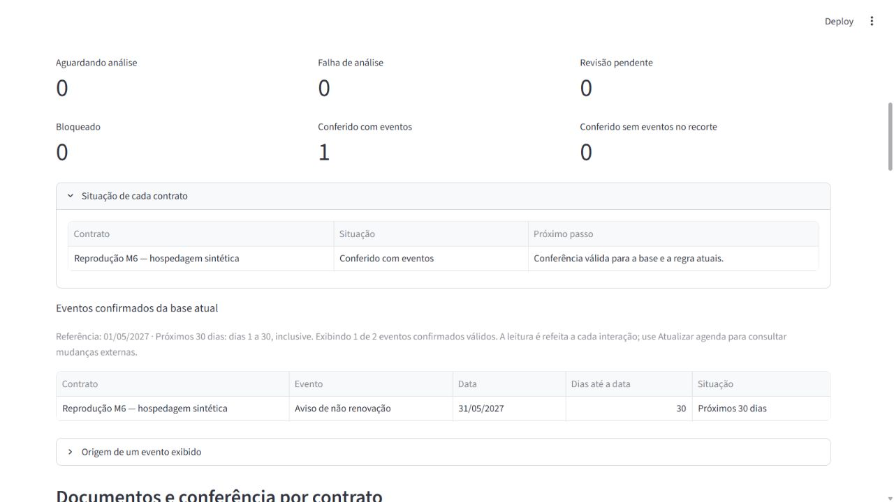

# Validação da reprodução e materiais de entrega

02/11/2026. Base funcional: `39befe7e8c3d52fb10a251f93d4515ca27a9ac8e`, PR #11. Branch deste bloco: `codex/reproducao-e-entrega`. Nenhuma regra de negócio, dependência, script de instalação ou código da aplicação foi alterado para obter estes resultados. Publicação e CI finais serão identificadas no PR deste bloco.

## Alcance executado

Criada cópia dos arquivos versionados por `git archive`, em diretório novo, sem `.venv`, `.tools`, `.uv-cache`, `var` ou pesos anteriores. A origem não foi clonada por rede; o arquivo e o commit de origem estão identificados no [JSON de evidências](evidencias/reproducao-m6.json). O teste usou a mesma máquina Windows e o Python 3.14.3 já instalado. Caches globais e sistema operacional não foram recriados.

O preparo foi executado pelo comando documentado `powershell -NoProfile -File scripts/Preparar-Ambiente.ps1`, sem ambiente virtual, caminho de importação ou diretório de dados herdados. Ele criou o bootstrap, instalou uv 0.13.6, baixou/sincronizou as 44 dependências e criou o banco em `0004_extractions`. A primeira consulta confirmou zero contratos e zero tentativas. O módulo importado e o executável Python pertenciam à cópia, não ao checkout de trabalho.

`powershell -NoProfile -File scripts/Validar-Projeto.ps1` passou nessa cópia: **371 testes em 21,79 s**, Ruff/formatação, lock, dependências e 47 arquivos/323 links locais. A contagem se refere ao snapshot reproduzido; os documentos deste bloco ainda não existiam nessa cópia. Não somar essa execução aos testes anteriores para inventar um total maior de cenários.

## Início, backup e fluxo de recuperação

| Etapa | Procedimento | Resultado observado |
|---|---|---|
| Início documentado | `Iniciar-Radar.ps1`, com porta 8503 na sessão, sem digest/modelo no checkout novo | Interface vazia abriu; cadastro sintético persistiu; aviso de IA não configurada manteve o caminho manual |
| Preparar documentos | Serviço da aplicação carregou DEV-001 no único cadastro criado pela interface | Uma revisão documental no banco isolado, sem alterar o banco de trabalho |
| Segundo preparo | Executar novamente `Preparar-Ambiente.ps1` com banco existente | Um backup criado; todos os valores das nove tabelas comparados por conteúdo e preservados; backup correspondeu à origem naquele instante |
| Falha controlada | Reiniciar o mesmo wrapper com digest de teste divergente, mantendo o runtime local existente | Tentativa 1 falhou e permaneceu visível na cobertura/histórico; nenhum vazio ou evento confirmado |
| Recuperação explícita | Conferir runtime/modelo e reiniciar com o digest correto; usuário simulado solicitou nova tentativa | Tentativa 2 concluiu, sem sobrescrever a falha; término 30/06/2027 e aviso 31/05/2027 propostos |
| Seleção/conferência | Escolher proposta, ler origem, declarar conferência simulada e confirmar | Escolher não confirmou; a confirmação separada publicou dois eventos |
| Recarga | Recarregar a página e conferir banco/histórico | Duas tentativas, uma conferência e dois eventos; nenhuma análise iniciada por recarregar |

O runtime Ollama 0.40.13 e o mesmo modelo Qwen3 4B Instruct Q4 foram reutilizados no loopback. O digest foi conferido contra os metadados do runtime antes da recuperação. Não foi exercitado download/instalação novos dos pesos ou do runtime nessa cópia; só o wrapper da aplicação e sua configuração explícita. A falha foi induzida, não um incidente espontâneo de produção. A nova inferência é uma reprodução de DEV-001 conhecido, sem ampliar a avaliação de qualidade ou repetir o conjunto de 20 casos.

O [JSON](evidencias/reproducao-m6.json) identifica o arquivo de origem, caminhos de ambiente/módulo, hashes de código/scripts/lock, backup, tentativas, modelo/digest e eventos. Todas as fontes de aplicação/scripts comparadas permaneceram idênticas entre os checkouts. A conferência foi executada pelo agente com personagens; não representa revisão real de Lucas.

## Materiais preparados e limites de conclusão

O [índice de entrega](entrega/README.md) reúne comandos reproduzíveis, roteiro, situação para revisão, cartão portátil e rascunhos para LinkedIn/comunidade. O cartão conserva os dois links obrigatórios vazios e avisa que não está pronto para submissão. Nenhum post, fork, PR da galeria ou merge foi feito.

O enunciado e as regras foram reabertos em 02/11/2026; a pasta `desafio-livre/projetos` foi conferida no repositório oficial. Os hashes de conteúdo consultados estão no [registro de fontes](evidencias/fontes-entrega.json). Essa consulta não valida o cartão nem os links ainda ausentes. `check_docs.py` verifica referências locais, não os metadados exigidos pela galeria.

Não houve alteração de código ou adição de testes artificiais para os materiais. Esta entrega tem evidência manual por capacidade: comandos de instalação/validação/início, isolamento de importação/dados, backup, recuperação na UI e rastreabilidade dos rascunhos. Na revisão documental, `check_docs.py` aprovou 54 arquivos e 365 referências locais, e `git diff --check` passou. A inspeção dos sete campos do cartão, imagem e JSON confirmou sua consistência, mantendo os dois links de posts deliberadamente vazios; não foi uma aprovação da galeria. A CI do PR será uma nova conferência do snapshot final, separada desta reprodução.

Faltam revisão de Lucas dos PRs/materiais, publicações e submissão se ele as autorizar, eventual vídeo, avaliação independente da extração e decisões posteriores sobre evolução/produção. Instalação em outra máquina/sistema operacional e avaliação por outra pessoa continuam sem comprovação. M6 avançou na reprodução local e nos materiais preparados; não declarar participação enviada, projeto aprovado ou produção pronta.
